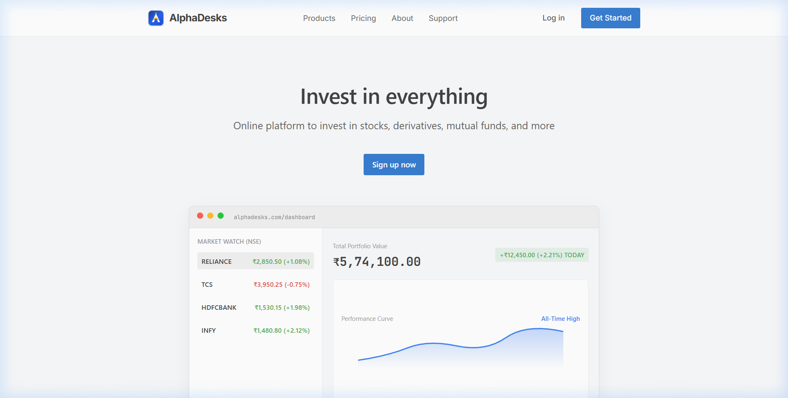
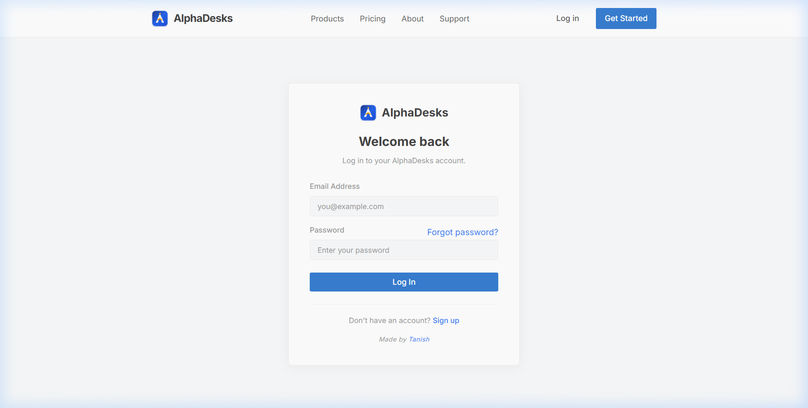
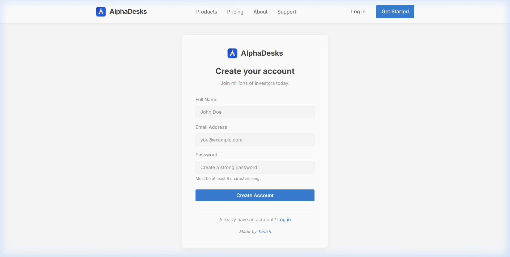
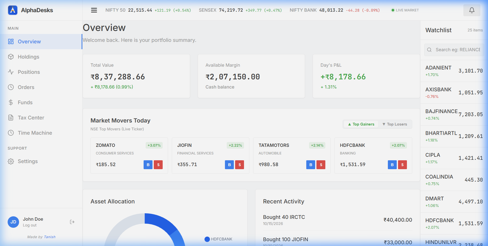
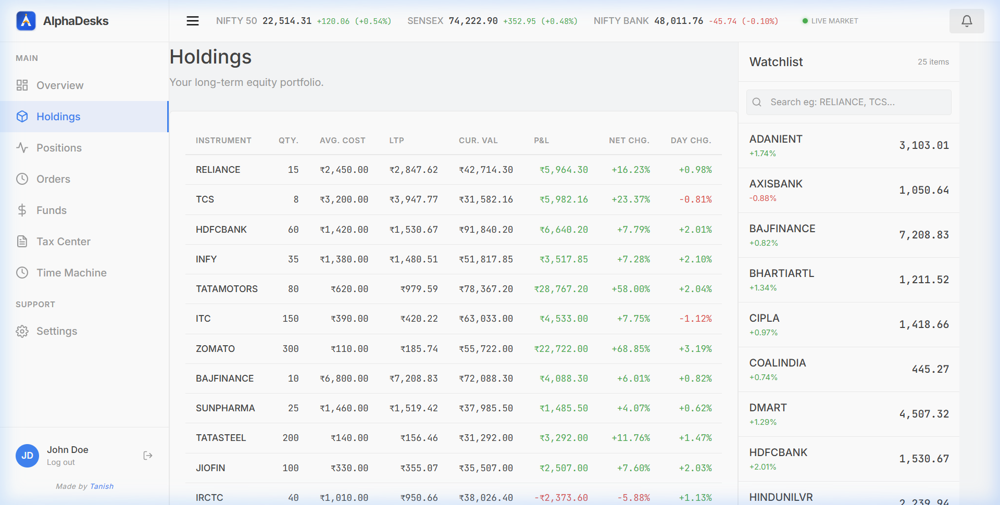
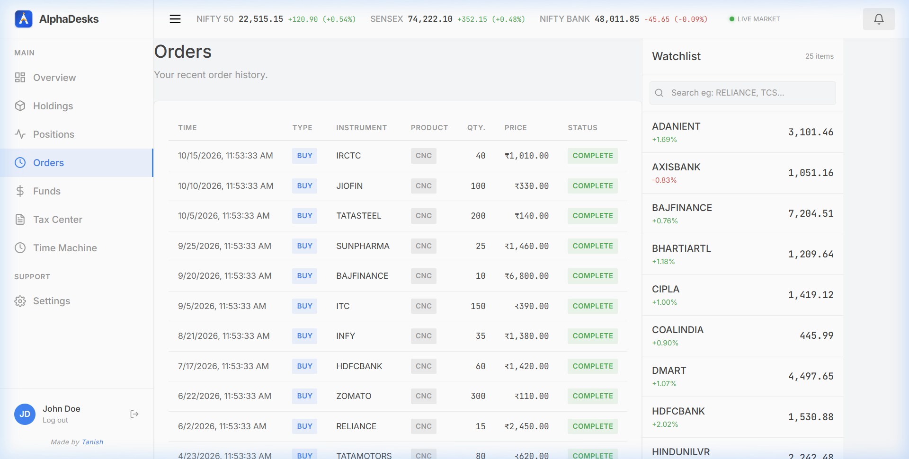
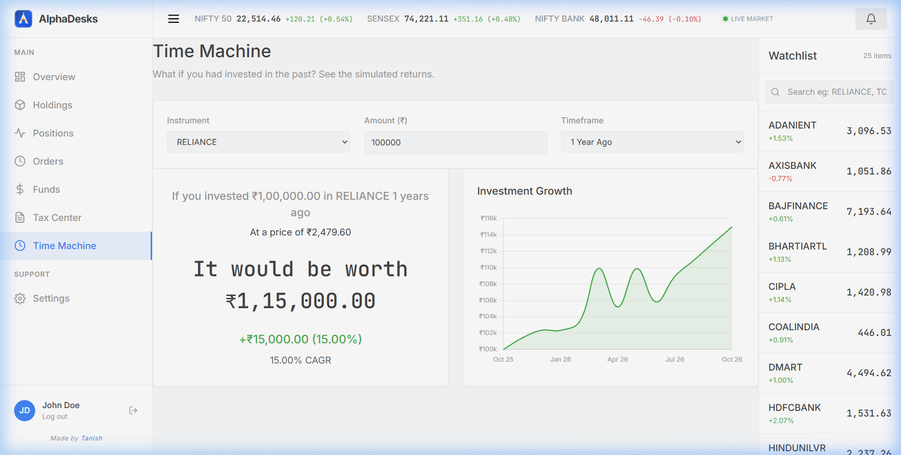
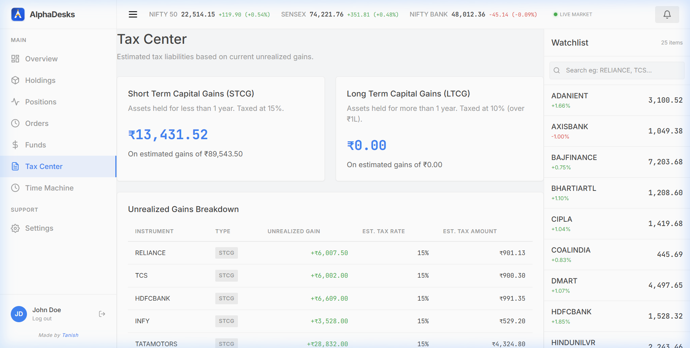

# AlphaDesks 📈

A modern, high-performance fintech trading and investment platform built on the **MERN** stack (MongoDB, Express, React, Node.js), inspired by platforms like **Zerodha Kite** and **Groww** — with a clean, minimalist, and responsive design.

---

## 📸 Screenshots

### Landing Page


### Login & Signup
| Login | Signup |
|:---:|:---:|
|  |  |

### Dashboard Overview


### Holdings & Orders
| Holdings | Orders |
|:---:|:---:|
|  |  |

### Time Machine — SIP & Lumpsum Simulator


### Tax Center — Capital Gains Breakdown


---

## ✨ Features

### 🏠 Landing Page
- Professional hero section with compelling tagline and call-to-actions
- Feature highlights with responsive card grid
- Smooth navigation to Login / Signup

### 🔐 Authentication
- Full user **Signup** and **Login** with JWT token management
- Passwords hashed with **bcryptjs**
- Persistent sessions with localStorage token storage
- Protected dashboard routes (auto-redirect to login if unauthenticated)

### 📊 Dashboard Overview
- **Total Portfolio Value** with real-time day P&L and percentage change
- **Available Margin** tracking (cash balance)
- **Day's P&L** computed from live instrument prices
- **Asset Allocation Doughnut Chart** — interactive Chart.js visualization of top holdings
- **Recent Activity Feed** — shows latest executed orders

### 🚀 Market Movers — Top Gainers & Losers *(Unique Feature)*
- Real-time tab-switchable view of **Today's Top Gainers** and **Top Losers**
- Displays stock symbol, LTP, absolute day change, and percentage change
- Color-coded green/red indicators for instant market sentiment
- One-click **BUY / SELL** directly from the movers panel — inspired by Groww and Zerodha

### ⏳ Time Machine — SIP & Lumpsum Simulator *(Unique Feature)*
- **Backtest any NSE stock** (Reliance, TCS, Infosys, HDFC Bank, etc.)
- Choose investment amount and time horizon (months ago)
- See **simulated CAGR**, total returns, and profit/loss
- **Interactive line chart** plotting historical growth trajectory
- Inspired by Groww's "If you had invested..." feature

### 🧾 Tax Center — Capital Gains Calculator *(Unique Feature)*
- Automatic classification of holdings into **Short-Term (STCG)** and **Long-Term (LTCG)**
- STCG taxed at **15%**, LTCG taxed at **10%** with ₹1,00,000 exemption
- Per-holding breakdown: invested value, current value, gain, tax type, and estimated tax
- Summary cards showing total STCG, LTCG, net tax liability, and effective tax rate
- Inspired by Zerodha Console's P&L tax reporting

### 🩺 Portfolio Health Score *(Unique Feature)*
- Automated **diversification scoring** (0–100) based on:
  - Number of unique holdings
  - Concentration risk (any single stock > 40% portfolio)
  - Sector exposure balance
- Actionable improvement tips and risk insights

### 🤖 Trade Copilot *(Unique Feature)*
- AI-style **automated trade insights** based on current holdings
- Detects over-concentration, underperformers, and high-conviction positions
- Personalized recommendations for portfolio rebalancing

### 💼 Holdings Management
- Full holdings table with buy price, current price, quantity, P&L, and percentage change
- Color-coded profit/loss indicators
- Real-time valuation using live instrument prices

### 📝 Order Execution
- Place **Market / Limit** orders (BUY and SELL)
- Trade modal triggered directly from Market Watch or Market Movers
- Automatic margin deduction and holdings update

### 💰 Funds & Margin
- View available balance, used margin, and total portfolio margin
- Transaction history with date-wise breakdown

### 📈 Live Market Data Simulation
- **30 NSE blue-chip instruments** seeded with realistic LTP, open, high, low, close prices
- Day change and percentage change computed per instrument
- Market data refreshes on each session for a realistic trading floor feel

### 🎨 Design & UX
- **Off-white canvas** (`#f8f9fa`) — clean, non-fatiguing background
- **Premium typography**: [Inter](https://fonts.google.com/specimen/Inter) for body, [JetBrains Mono](https://fonts.google.com/specimen/JetBrains+Mono) for data/numbers
- **Custom luxury tycoon logo** (AlphaLogo) — gold-accented geometric crest
- **"Made by Tanish"** signature on every page footer
- Responsive sidebar navigation with hover effects
- Smooth CSS transitions and micro-animations throughout
- Accessible contrast ratios and focus states

---

## 🏛️ Architecture

| Component    | Stack                                                 | Default Port |
| :----------- | :---------------------------------------------------- | :----------- |
| **Frontend** | React 18, React Router v6, Chart.js, React-ChartJS-2  | `3000`       |
| **Backend**  | Node.js, Express, Mongoose, JWT, bcryptjs              | `3002`       |
| **Database** | MongoDB (Local fallback or Atlas cluster)              | `27017`      |

---

## 🚀 Quick Start Guide

### 1. Prerequisites
- **Node.js** (v18+ recommended)
- **MongoDB** (Local instance on `mongodb://127.0.0.1:27017` or MongoDB Atlas URI)

### 2. Install Dependencies
From the repository root, install dependencies for root, backend, and frontend in one step:
```bash
npm run install:all
```

### 3. Configure Environment Variables
Inside `backend/.env`:
```env
MONGO_URL=mongodb://127.0.0.1:27017/alphadesks
PORT=3002
JWT_SECRET=your_jwt_secret_key
```
*(The backend automatically falls back to your local MongoDB server if remote Atlas DNS is unreachable).*

### 4. Seed Demo Data
Populate real-market instruments, mock holdings, and initial balances:
```bash
node backend/seed/seed.js
```

### 5. Launch the Application
Start both frontend and backend concurrently:
```bash
npm start
```
- Open [http://localhost:3000](http://localhost:3000) to view the client app.
- Backend API runs on [http://localhost:3002/api](http://localhost:3002/api).

---

## 📁 Project Structure

```
├── backend/
│   ├── config/          # DB connection & JWT verification
│   ├── models/          # User, Holding, Order, Position, Fund, Instrument
│   ├── routes/          # Auth, Holdings, Orders, Funds, Instruments
│   ├── seed/            # Database initialization script (30 NSE instruments)
│   └── server.js        # Express app entry point
├── frontend/
│   ├── src/
│   │   ├── components/
│   │   │   ├── common/      # Navbar, Footer, AlphaLogo, LoadingSpinner
│   │   │   └── dashboard/   # DoughnutChart, LineChart, MarketMovers,
│   │   │                    # PortfolioHealth, TradeCopilot, Sidebar, TradeModal
│   │   ├── context/         # PortfolioContext & TradeContext
│   │   ├── pages/
│   │   │   ├── dashboard/   # Overview, Holdings, Orders, Positions,
│   │   │   │                # Funds, TimeMachine, TaxCenter, Settings
│   │   │   ├── HomePage.js
│   │   │   ├── LoginPage.js
│   │   │   └── SignupPage.js
│   │   ├── styles/          # Design system (variables, components, landing, dashboard)
│   │   └── utils/           # formatINR helper
│   └── public/
├── screenshots/             # App screenshots for README
└── package.json             # Workspace scripts & Concurrently setup
```

---

## 🛠️ Tech Stack

| Technology       | Purpose                              |
| :--------------- | :----------------------------------- |
| React 18         | Frontend UI framework                |
| React Router v6  | Client-side routing                  |
| Chart.js         | Interactive charts & visualizations  |
| Node.js          | Backend runtime                      |
| Express          | REST API server                      |
| MongoDB          | NoSQL database                       |
| Mongoose         | MongoDB ODM                          |
| JWT              | Authentication tokens                |
| bcryptjs         | Password hashing                     |
| Concurrently     | Run frontend + backend together      |

---

## 📄 License
This project is open-source and available under the [MIT License](LICENSE).

---

<p align="center"><i>Made by <b>Tanish</b></i></p>
